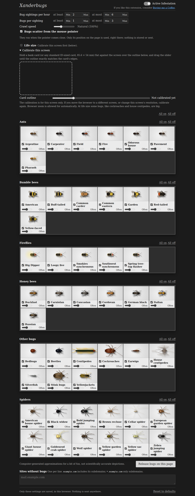
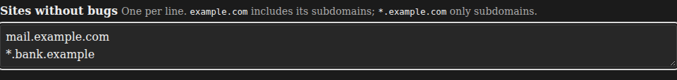

# Xanderbugs

If you like this extension, consider [buying me a coffee](https://buymeacoffee.com/xanderphillips).

A Chrome extension (Manifest V3). While you browse, it sends procedurally drawn bugs (ants, cockroaches, centipedes, spiders, silverfish, beetles, earwigs, yellowjackets, stink bugs, bedbugs, house centipedes) scurrying across the page. Walking bugs give each other room and steer round one another, and ants that meet head on sometimes stop face to face to touch antennae.

Everything is configurable on the settings page: bug sightings per hour, bugs per sighting, crawl speed, which bugs can appear and how often each one is picked, and sites where bugs should never appear.

## Install

### Manual install (unpacked)

Until the Chrome Web Store listing is live, load the extension manually. Chrome may show a "developer mode extensions" notice on startup; that's expected.

1. Go to the [latest release](https://github.com/SixAcreApiary/xanderbugs/releases/latest) and download `xanderbugs-vX.Y.Z.zip` (under **Assets**).
2. Unzip it somewhere you'll keep it (Chrome loads the extension from this folder, so don't delete it). You'll get a `xanderbugs` folder.
3. In Chrome, go to `chrome://extensions`.
4. Turn on **Developer mode** (top-right toggle).
5. Click **Load unpacked** and choose the `xanderbugs` folder (the one containing `manifest.json`).

Unpacked installs don't update themselves. To be notified of new versions, click **Watch > Custom > Releases** at the top of this repo on GitHub. To update, replace the contents of your `xanderbugs` folder with the new release, then click the reload icon on the extension's card in `chrome://extensions`. Your settings are kept.

To run unreleased code, build it yourself (see [Build from source](#build-from-source)).

## Configuration

Open the settings page by right-clicking the toolbar icon and choosing **Options**. Changes save automatically as you make them.



| Setting | What it does | Default |
|---|---|---|
| **Active Infestation** | Master on/off switch for scheduled sightings. Also available from the toolbar icon's right-click menu. | On |
| **Bug sightings per hour** | How many times per hour bugs show up, picked at random between *at least* and *at most* (0 to 60). The **Min**/**Max** buttons jump to the limits. | 2 to 6 |
| **Bugs per sighting** | How many bugs appear in each sighting (1 to 20). | 1 to 3 |
| **Crawl speed** | How fast bugs move, from 25% to 250% of natural speed. **Reset to normal speed** returns it to 100%. | 100% |
| **Bug types** | Tick a bug to allow it. Its **How often** slider sets how likely it is to be picked compared with the other ticked bugs. | All bugs, equal weight |
| **Release bugs on this page** | Sends a sighting across the settings page right away so you can preview your choices. | |
| **Sites without bugs** | One site per line where bugs never appear. `example.com` also covers its subdomains; `*.example.com` covers only subdomains. Invalid lines are flagged and ignored. | Empty |
| **Reset to defaults** | Restores every setting above. | |



Click the toolbar icon to release a wave of bugs on the current tab whenever you like (a brief "!" on the icon means they can't go there; hover for why).

## About the bugs

The bugs are computer-generated approximations drawn in code. Their shapes, colours, leg placement and walking patterns are loosely inspired by the real animals, but they are meant to be convincing at a glance, not scientifically accurate depictions.

## Privacy

Full policy: [PRIVACY.md](PRIVACY.md).

- The only thing stored is the settings object, in `chrome.storage.local` (not `sync`, so it never leaves the device through browser sync).
- No network requests at all: extension pages run under `connect-src 'none'`, and `test/privacy.test.js` fails the build if network APIs or remote URLs appear in shipped code.
- The content script reads only `location.hostname`, to check your list of sites without bugs. It never reads page content.
- No extension files are exposed to web pages.
- The settings page has a "Buying me a Coffee" link to buymeacoffee.com. Nothing is sent there unless you click it, and that site's own privacy policy then applies.
- Permissions: `storage`, `alarms` and `contextMenus` (the right-click **Active Infestation** switch), plus a content script on http(s) pages.

## Build from source

```sh
npm install
npm run build          # outputs dist/
```

Open `chrome://extensions`, turn on Developer mode, choose **Load unpacked**, and select the `dist/` folder.

`npm run zip` produces `xanderbugs-v<version>.zip` (the same zip a release publishes). `npm run screenshots` regenerates the README screenshots in `docs/screenshots/` and the store screenshots, promo tile and demo video in `store/` (add `-- --no-video` to skip the video; the `.mp4` needs ffmpeg). `npm run icons` renders `icons/icon.svg` (a black ant on white) to the PNG toolbar icons; it needs the Playwright Chromium.

## Tests

```sh
npm test                       # unit tests: settings, scheduler, blocklist, messages, bug engine, privacy, store assets
npx playwright install chromium
npm run test:e2e               # loads dist/ into headless Chromium and exercises bugs, settings, storage, network
```

## Releasing

1. Bump the version (patch by default) in both `manifest.json` and `package.json`, and merge to `master`.
2. Tag and push: `git tag v1.2.3 && git push origin v1.2.3`.

The [Release workflow](.github/workflows/release.yml) runs the tests, builds the extension, packages it with `scripts/package.py` (which refuses a tag that doesn't match the manifest version) and publishes a GitHub Release with auto-generated notes. Run `npm run zip` locally to build the same zip.

## Chrome Web Store

[docs/web-store-listing.md](docs/web-store-listing.md) holds the copy-paste text for each Developer Dashboard tab: description, permission justifications, privacy answers and reviewer test instructions. The store images and video are in `store/`, captured from `store/mock-site/`, a fictional site with original text and no third-party assets.

## License

[MIT](LICENSE)

## Layout

| Path | Purpose |
|---|---|
| `src/background/sw.js` | Scheduling (chrome.alarms) and dispatch |
| `src/content/content.js` | Bug overlay on web pages (bundled to `content.bundle.js`) |
| `src/lib/bugs/` | Movement engine, leg/gait system and species renderers |
| `src/options/` | Settings page |
| `store/` | Chrome Web Store screenshots, promo tile, demo video and the mock site they are captured from |
